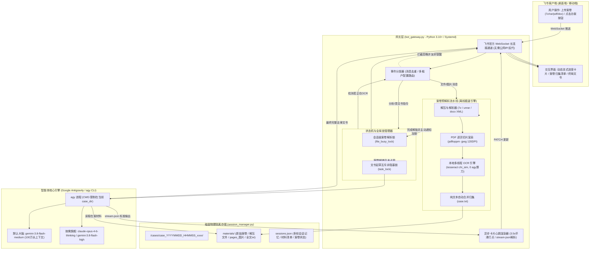

# ⚖️ 甘肃乾祐法律实务智能体 (Qianyou Legal Agent) 架构与技术规范规范书

> **面向 AI 智能体与核心开发者的技术白皮书**  
> 本文档旨在为任何接入、维护、扩展或调试本项目的 AI 智能体（LLM Coding Agents）提供详尽、权威、无歧义的系统架构、数据流向、状态机、并发锁模型与实务办案指引。任何 AI 在阅读本文档后即可对本系统的每一个核心模块实现 100% 的透彻理解。

---

## 1. 核心定位与业务场景

**甘肃乾祐法律实务智能体** 是依托 **飞书官方 WebSocket 长连接网关（Feishu Agent Gateway）** 与 **Google Antigravity（agy）智能体内核** 深度打造的专业民商事诉讼辅助智能体。

### 1.1 核心业务能力
1. **全格式案卷材料穿透解析**：用户在飞书端上传起诉状、答辩状、民事判决书、借款担保合同、抵押登记证明、破产申报材料等，系统支持 `.docx`、`.pdf`（文字版及纯图片扫描版）、各类压缩包（`.7z`、`.rar`、`.zip`、`.tar` 等）以及证据原图。
2. **离线图文识别（本地高精 Pre-OCR）**：在材料接收阶段，自动调用本地多线程 Tesseract OCR 引擎提取扫描件文字，**0 API 成本、0 外部网络请求、0 agy 算力消耗**，将生成法律文书的等待耗时从 4 分钟直接降至 **15～25 秒**。
3. **物理级防串案与案件隔离**：为每一次独立办案生成专有隔离目录（`case_dir`），agy 智能体进程的物理执行目录（CWD）被牢牢限制在当前案卷目录内，指令中注入防串案最高铁律，从根源杜绝 A 案事实流入 B 案。
4. **甘肃乾祐律师事实穿透与举证责任分配（模版 A / 模版 B）**：严格依照《最高人民法院关于适用〈中华人民共和国民事诉讼法〉的解释》第90条及民商事实体法规则，出具高规格《法律意见书》、《民事答辩状》、《民事代理词》。

---

## 2. 总体架构与数据流图



---

## 3. 核心子系统与工程实现细节

### 3.1 案件物理级隔离体系 (`session_manager.py`)
为彻底防止法律机器人将不同当事人、历史案件的文件或事实混杂，系统抛弃了传统的“单一大工作区”模式，改为**“每次办案独立物理沙盒”**：

1. **隔离目录命名规则**：
   ```python
   case_dir = os.path.join(base_project_dir, "cases", f"case_{ts}_{short_id}")
   # 示例：/home/shenb/.gemini/antigravity-cli/scratch/cases/case_20261107_000759_e5edfd
   ```
2. **触发新建案卷工作区的时机**：
   - 用户发送或点击快捷按钮 **【新案件】**；
   - 用户发送或点击 **【结束归档】** 后再发送新消息；
   - 会话闲置超时（`CASE_IDLE_RESET_SECONDS = 1800`，30分钟无交互自动归档历史会话）；
   - 上一案卷文书已交付完毕，用户上传了一批新的案卷归档包或材料。
3. **agy 执行限制（防串案铁律）**：
   在 `execute_agent_task` 启动 `agy` 子进程时，强制将 `cwd=work_dir`（即当前的 `case_dir`）。同时在首轮 Prompt 中注入最高优先级安全红线：
   ```text
   【防串案与材料隔离铁律（最高优先级）】：
   1. 本次研判与文书起草，严格仅限依据上方【本案唯一在案材料清单】中列明的文件及本次对话事实！
   2. 绝对禁止访问父目录（..）或搜索 scratch 下的其他文件夹！
   3. 若用户指令点名了特定当事人，但清单中完全没有该当事人材料，立即停止起草并明确提示用户漏传，绝不允许拿无关案件强行拼凑！
   ```

---

### 3.2 案卷预解析流水线与本地 Pre-OCR (`bot_gateway.py`)

传统方案直接把 69 页扫描件传给大模型，模型需要在运行阶段编写脚本、临时调用 OCR，导致用户等待 4 分钟以上。本网关采用了**“移峰填谷”**的工程方案：

1. **零依赖 `.docx` 解析**：
   利用 Python 标准库 `zipfile` 和 `xml.etree.ElementTree` 提取 `word/document.xml`，毫秒级读取表格与正文，无第三方臃肿依赖。
2. **多层归档包自动解压**：
   集成 `/usr/bin/7z` 与 `/usr/bin/unrar`，递归解压 `.7z`、`.rar`、`.zip` 等格式，自动跳过 macOS/Windows 临时元文件（如 `._*`、`desktop.ini`）。
3. **扫描件 PDF 逐页高清渲染**：
   调用 `/usr/bin/pdftoppm -jpeg -r 120` 将 PDF 页面渲染为 120 DPI 的高品质 JPEG 原件。
4. **多线程本地 Tesseract OCR**：
   ```python
   def ocr_single_image(img_path: str) -> str:
       # 调用本地 /usr/bin/tesseract，纯 CPU 运算，0 agy 算力、0 API 费用
       res = subprocess.run([TESSERACT_BIN, img_path, "stdout", "-l", "chi_sim", "--oem", "1"], ...)
   ```
   使用 `ThreadPoolExecutor(max_workers=2)` 并行化识别，并将提取出的文本按页头合并存入 `<case_name>.txt`。
5. **极速注入**：
   当用户点击【出具法律意见书】时，预解析文本（如 35,000 字）已被直接结构化提供，模型无需任何读图耗时，**15～25 秒即可瞬间起草完成**。

---

### 3.3 状态机与两级锁模型

为了保障高并发与防扰乱体验，网关设计了两级互斥锁：

```mermaid
stateDiagram-v2
    [*] --> Idle: 机器人就绪

    state FileProcessing {
        [*] --> Downloading: 接收材料
        Downloading --> Unpacking: 自动解压
        Unpacking --> Rendering: 高清渲染
        Rendering --> OCRing: 本地高精OCR
        OCRing --> Completed: 写入materials/*.txt
    }

    Idle --> FileProcessing: 用户发送文件/压缩包/图片 (加 file_busy_lock)
    
    state FileProcessing {
        note right of FileProcessing
            此期间用户点击【分析/意见书】
            触发 file_busy_sessions 拦截
            -> 忽略执行并友好提示锁止
        end note
    }

    FileProcessing --> ReadyForAnalysis: 释放 file_busy_lock\n主动推送【案卷材料解析完毕】

    ReadyForAnalysis --> AgentExecuting: 用户点击【意见书/答辩状】(非阻塞获取 task_lock)
    
    state AgentExecuting {
        note right of AgentExecuting
            此期间重复点击
            task_lock.acquire(False) 返回 False
            -> 拦截重复起草，杜绝排队浪费
        end note
        GeneratingCard: 实时进度卡片打点 (3.5s Ticker)
        StreamingStdout: 零缓存实时解析 stream-json
    }

    AgentExecuting --> ReadyForAnalysis: 交付完整法律文书 (释放 task_lock)
    ReadyForAnalysis --> Idle: 用户发送【新案件】或【结束归档】
```

1. **第一级：会话级案卷解析锁 (`file_busy_lock` / `is_session_file_busy`)**
   - **加锁范围**：材料接收 -> 解压 -> 高清切片 -> OCR 识别。
   - **行为**：此时若用户心急点击【出具法律意见书】或【综合案情研判】，消息处理器在 `on_message_received` 顶部直接拦截，发送带有 4 秒节流保护的锁定提醒，**不向 agy 提交任何半成品分析**。
   - **完成机制**：解析 100% 完毕后，底层在会话底部主动发出一条醒目的 `@提示消息`：`🔔 【案卷材料解析完毕 · 请指示】`，告知用户操作锁已解除。
2. **第二级：智能体起草互斥非阻塞锁 (`task_lock.acquire(blocking=False)`)**
   - **加锁范围**：文书撰写全过程。
   - **行为**：若用户连击多次【出具法律意见书】，后续点击立即返回 `⏳【办案研判进行中】当前已有法律分析或文书起草任务正在深度研判中`，杜绝后台排队重复跑 3 次上万字文书。

---

### 3.4 实时流式进度卡片与 Ticker 打点机制

在处理复杂法律诉讼时，为了杜绝给用户“程序死机”的假象，系统实现了飞书交互卡片与 `agy` 执行流的深度实时同步：

1. **毫秒级首张卡片反馈**：指令到达的第 1 毫秒即回复首张交互卡片（初始进度 10%），标题为案由诉求简述。
2. **平滑进度递增后台打点（Ticker Worker）**：独立守护线程每 3.5 秒平滑递增百分比进度条（`10% -> 35% -> 70% -> 96%`），显示已研判秒数。
3. **零缓存实时解析 `stream-json`**：
   使用 `for line in iter(proc.stdout.readline, ""):` 绕过 Python `TextIOWrapper` 内部的 8KB 块缓存延迟，即时拦截 `agy` 发送的每一个 `step_update`：
   - 遇到 `read_file` 动作：卡片实时变更为 `正在精读在案证据《XXX》...`
   - 遇到 `run_command` 动作：实时显示命令提要；
   - 遇到 `agent_response` 思考块：实时显示正在研判的具体争议焦点；
4. **终局交付**：任务完成时卡片就地变为绿色 `✅ 法律研判与文书起草完成 (100%)`，并在对话框下方输出完整文本正文。

---

## 4. 甘肃乾祐律师事务所实务文书标准与 Prompt 体系

在 `bot_gateway.py` 内部，针对法律机器人的四大快捷操作预设了符合乾祐律师实务体例的顶层 Prompt 规范：

### 4.1 模版 A：《法律意见书》
```text
出具专业法律意见书。严格按照甘肃乾祐律师事务所标准体例（模版A）出具完整严谨的《法律意见书》。
全面梳理审查查明事实、针对争议焦点进行事实穿透与要件对齐（结合《民法典》、《民诉法解释》第90条举证责任分配逐项论证）、
进行客观诉讼风险评估，并出具明确的综合法律意见与办案实务操作方案建议。全文纯文本呈现，严禁任何外部URL链接。
```

### 4.2 模版 B：《民事答辩状》
```text
起草民事答辩状。严格以甘肃乾祐律师事务所出庭律师身份，站在我方答辩人/被上诉人立场，
按照甘肃乾祐律师事务所标准体例（模版B）起草完整正规的《民事答辩状》。
包含当事人身份信息、明确答辩请求、逐项针对原告/上诉人诉求反驳的事实与理由（穿透事实要件、抗辩事实与举证证明责任分配、精准援引法律条款）、送达法院与具名落款。全文纯文本呈现，严禁任何外部URL链接。
```

### 4.3 模版 C：《民事代理词》
```text
起草民事代理词。严格以甘肃乾祐律师事务所出庭代理律师身份，站在我方委托人立场，起草完整正规、论证严密的《民事代理词》。
内容包含：称谓（尊敬的审判长/审判员）、代理人身份声明、明确核心代理意见与主张、紧扣争议焦点进行深入事实穿透与要件论证、详述证据链闭环情况、结合民事诉讼举证责任分配规则（《民诉法解释》第90条）及实体法条款进行充分抗辩与法理论证、恳请法庭支持我方主张之总结及代理人具名落款。全文条理清晰、纯文本规范呈现，严禁任何外部URL链接。
```

### 4.4 《综合案情研判》
```text
进行深度事实穿透与法律综合研判。严格以甘肃乾祐律师事务所专业法律智能助手身份办理，通读在案全部材料与案情，严禁反问。
全面梳理核心法律事实与证据链条（证实事实、存疑点、证据瑕疵）、争议焦点归纳、举证责任分配与证明标准评估（《民诉法解释》第90条）、诉讼法律风险与实体应对策略。全文条理清晰、纯文本呈现，严禁任何外部URL链接。
```

---

## 5. 多租户配置与部署指南

### 5.1 配置文件结构 (`config.chenjia.json`)
```json
{
  "app_id": "cli_aa6c235eb338dce0",
  "app_secret": "****************************",
  "bot_name": "陈佳的智能助手",
  "bot_type": "legal",
  "default_model": "gemini-3.8-flash-medium",
  "root_dir": "/home/shenb/.gemini/antigravity-cli/scratch"
}
```

### 5.2 启动与多实例服务托管 (Systemd)
在多租户服务器上，通过 Linux 用户级 Systemd 单元管理：

```bash
# 启动陈佳法律助手专用实例
systemctl --user start feishu-agent@chenjia.service

# 查看实时日志
journalctl --user -u feishu-agent@chenjia.service -f

# 设置开机自启
systemctl --user enable feishu-agent@chenjia.service
```

### 5.3 依赖安装清单
宿主机需要安装以下工具：
```bash
# Ubuntu / Debian
sudo apt-get update
sudo apt-get install -y tesseract-ocr tesseract-ocr-chi-sim poppler-utils p7zip-full unrar-free python3-pip

# Python 依赖
pip install lark-oapi requests pypdf
```

---

## 6. AI 智能体维护与扩展指引 (For Coding Agents)

当后续有其他 AI 助手（如 Copilot、Claude、Gemini、Cursor）需要修改或调试本项目时，请遵循以下技术准则：

1. **修改锁逻辑**：任何关于文件解析的逻辑扩展必须包裹在 `set_session_file_busy` 与 `try...finally: clear_session_file_busy` 之间，严禁遗漏清理，防止会话永久死锁。
2. **修改 OCR 逻辑**：本地 OCR 是使用 Tesseract 保证离线执行并规避大模型 Token 计费的核心机制。严禁改用调用云端多模态 API 来替换本地 OCR，否则会大幅增加 Token 消耗并引发延迟回退。
3. **保持防串案机制**：严禁在 `bot_gateway.py` 或 `session_manager.py` 中将工作目录回退为父级大目录（如 `/scratch`），所有文件读写和任务执行必须严格限制在 `case_dir` 下。
4. **流式输出兼容**：读取 `proc.stdout` 时必须使用 `iter(proc.stdout.readline, "")`，严禁使用普通的 `for line in proc.stdout`，否则会导致 Python 内部的 8KB 块缓存延迟，造成飞书卡片状态无法实时刷新。
