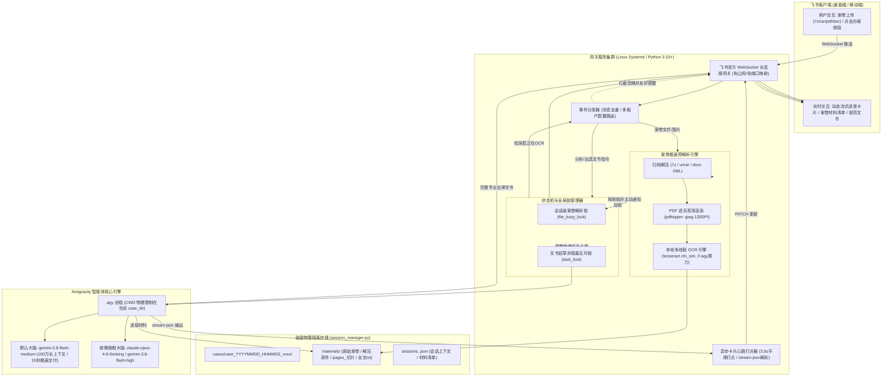

# 🤖 Feishu Agent Gateway (飞书全能智能体网关) & ⚖️ 乾祐法律实务智能体

[](https://opensource.org/licenses/MIT)
[](https://www.python.org/downloads/)
[](https://open.feishu.cn/)
[](https://antigravity.google)

基于飞书官方 **WebSocket 长连接（无需公网 IP、无需域名、无需内网穿透）**，将 **Google Antigravity 编码/法律智能体** 深度接入飞书客户端的高可用网关系统。

不仅支持在手机或电脑飞书随时下发 Linux 运维命令、编写与调试代码、切换不同项目工作区，更内建了行业标杆级的 **甘肃乾祐律师事务所专业实务法律智能体**，支持百页案卷秒级解析与高规格诉讼文书起草。

> 📖 **面向 AI 智能体开发者的专业技术白皮书**：详见 [LEGAL_AGENT_SPEC.md](LEGAL_AGENT_SPEC.md)。

---

## 🌟 核心特性总览

### 1. 通用网关与协同底座
- ⚡ **零公网依赖**：采用官方 WebSocket 长连接模式，任何处于内网、云开发机或私有 VPS 的主机均可秒级接入，彻底告别域名、SSL 证书与反向代理。
- 🤖 **单内核并发多租户 / 多机器人**：支持 1 个 Antigravity 智能体（`agy`）同时驱动 \(n\) 个飞书企业/个人账号下的 \(m\) 个机器人，多实例进程级隔离、会话与存储天然物理独立。
- 🔍 **零配置机器人自动探测**：启动时自动调用飞书官方 OpenAPI 获取机器人名称与 Open ID，告别硬编码。
- 📁 **多项目工作区隔离**：自动扫描工作区目录，支持使用 `/project <名>` 秒级切换。
- 🌳 **飞书话题群（Topic Group）1:1 映射**：群组 = 项目工作区，群内话题 = 独立会话，左侧话题列表一目了然，右侧独立承接上下文。
- 💬 **彻底免 @ 直接交互**：群内无需每次艾特机器人，打字按回车即刻响应。
- 🛡️ **开机与崩溃自愈守护**：通过 Linux Systemd 模板服务托管，配置 Linger 免登录自启，服务永久在线。

### 2. ⚖️ 甘肃乾祐法律实务智能体专属特性 (Qianyou Legal Edition)
- 🔒 **案件目录级物理隔离（防串案最高铁律）**：为每一次独立办案生成独立的物理目录（`cases/case_YYYYMMDD_HHMMSS_<rand>/`），进程执行目录物理锁死，绝对禁止跨案串卷。
- ⚡ **本地高精 Pre-OCR 移峰填谷（0 agy 算力消耗）**：
  - 针对大文件扫描件 PDF、压缩包（`.7z`、`.rar`、`.zip`）及证据图片，自动在文件上传阶段调用本地多线程 Tesseract OCR 引擎提取文字。
  - **完全不消耗云端大模型 Token 费用与 agy 步骤**，将意见书生成耗时从 4 分钟直接降至 **15～25 秒**！
- 🛑 **会话级解析防扰互斥锁 (`file_busy_lock`)**：
  - 案卷解压与 OCR 期间，系统自动锁定并忽略用户提前发起的分析点击，内置防刷屏节流提示。
  - 全部材料解析完毕后，在会话底部主动发出醒目的【案卷材料解析完毕 · 请指示】就绪提醒。
- 📊 **动态流式实时卡片（0 缓存延迟）**：
  - 毫秒级初始交互卡片响应；
  - 3.5 秒平滑递增打点动画（`[████████░░] 65%`）；
  - 基于 `stream-json` 零缓存实时解析，精确显示“正在精读在案证据《XXX》...”、“正在起草文书正文...”。
- 📝 **乾祐律师实务体例与法理规则穿透**：
  - 严格依照《民诉法解释》第90条举证责任分配与证明要件对齐；
  - 模版 A《法律意见书》、模版 B《民事答辩状》、《民事代理词》、《综合案情研判》一键规范出具。

---

## 🚀 架构设计



---

## 📖 交互指令与操作指南

### 1. ⚖️ 法律机器人专属交互指令（支持点击卡片按钮或直接回复文字）

| 快捷指令 | 包含别名 | 作用说明 |
| :--- | :--- | :--- |
| **`【综合案情研判】`** | `综合案情研判`、`案情研判`、`分析`、`法律分析` | 全面梳理核心法律事实与证据链条（证实事实、存疑点、证据瑕疵），穿透争议焦点，评估举证责任与诉讼风险。 |
| **`【出具法律意见书】`** | `法律意见书`、`意见书`、`起草法律意见书`、`写意见书` | 严格按照甘肃乾祐律师事务所**模版 A 标准体例**秒级出具完整严谨的《法律意见书》（事实查明、争议焦点对齐、实体与程序法评估、实操方案）。 |
| **`【起草民事答辩状】`** | `民事答辩状`、`答辩状`、`答辩词`、`起草答辩状` | 严格以甘肃乾祐律师事务所出庭律师身份，站在我方答辩人立场出具**模版 B 标准体例**《民事答辩状》（针对诉请逐项反驳、抗辩事由与举证责任分配）。 |
| **`【起草代理词】`** | `民事代理词`、`代理词`、`起草代理词`、`代理意见` | 站在我方委托人立场起草完整正规、论证严密的出庭《民事代理词》（法庭称谓、证据闭环证明力、法条深度援引、主张请求总结）。 |
| **`【新案件】`** | `新案`、`办理新案件`、`下一案件` | 彻底重置并物理归档当前案件，**自动创建全新的独立案卷隔离工作区**，新案卷归集从零开始，杜绝串案。 |
| **`【结束归档】`** | `结案`、`结案归档`、`归档` | 将当前案件正式结案封存并闭环隔离，释放工作区。 |

---

### 2. 通用工作区与运维指令

| 指令 | 别名 | 作用说明 |
| :--- | :--- | :--- |
| **`/help`** | `帮助`、`/menu`、`/card` | 弹出 **🤖 工作台控制面板** 交互卡片 |
| **`/status`** | `状态` | 查看当前工作区目录、模型、会话 ID 与近期任务记录 |
| **`/model`** | `模型` | 查看或切换模型（如 `/model pro`、`/model high`、`/model reset`） |
| **`/projects`**| `项目`、`/项目列表` | 弹出 **📂 项目工作区列表** 卡片，展示所有可用本地项目 |
| **`/project <名>`** | `切项目` | 切换工作目录至目标项目（如 `/project 飞书`），并重置上下文 |
| **`/new`** | `新建会话`、`/clear` | 开启全新会话，上一会话自动归档至历史记录 |
| **`/history`** | `历史`、`历史会话` | 弹出 **📜 历史会话列表** 卡片，列出近期会话及轮次 |
| **`排盘`** | `起盘`、`算卦` | 内置双轨排盘引擎，支持真太阳时推演与连发解读 |

---

## 🛠️ 飞书开放平台准备（3 分钟）

在 [飞书开放平台开发者后台](https://open.feishu.cn/app) 进入或创建自建应用：

1. **添加机器人能力**：在「添加应用能力」中添加「机器人」。
2. **开通核心权限**（「开发配置 -> 权限管理」）：
   - `获取单聊消息` (`im:message.p2p_msg:readonly`)
   - `获取群聊中被@的消息` (`im:message.group_at_msg:readonly`)
   - `获取群聊消息` (`im:message.group_msg:readonly`，实现免 @ 必开)
   - `以应用的身份发消息` (`im:message:send_as_bot`)
3. **配置事件订阅**：
   - 进入「开发配置 -> 事件与回调」；
   - 订阅方式选择 **「长连接模式」**；
   - 添加事件：**`接收消息 (im.message.receive_v1)`**。
4. **发布版本**：
   - 在「版本管理与发布」中提交并发布一次版本即可。

---

## 📦 部署与运行

### 1. 系统底层依赖安装
```bash
# Ubuntu / Debian
sudo apt-get update
sudo apt-get install -y tesseract-ocr tesseract-ocr-chi-sim poppler-utils p7zip-full unrar-free python3-pip

# Python 依赖
pip install lark-oapi requests pypdf
```

### 2. 配置文件
创建 `config.chenjia.json`（或默认 `config.json`）：
```json
{
  "app_id": "cli_aa6c235eb338dce0",
  "app_secret": "****************************",
  "bot_name": "陈佳的智能助手",
  "bot_type": "legal",
  "default_model": "gemini-3.8-flash-medium",
  "root_dir": "/home/shenb/.gemini/antigravity-cli/scratch"
}
```

### 3. Systemd 用户服务托管
```bash
# 启动法律助手实例
systemctl --user enable --now feishu-agent@chenjia

# 查看状态与实时流式日志
systemctl --user status feishu-agent@chenjia
journalctl --user -u feishu-agent@chenjia -f
```

---

## 📄 开源许可证

本项目基于 [MIT License](LICENSE) 开源。
